# FCC to Warthog Adapter

FCC is a force sensing core originally created for the now vintage Thrustmaster Cougar.  
FCC was produced in several versions by Arend van Oosten also known as "WhiteEagle" until his passing in 2018. FCC was designed to be mounted in a replica F-16 cockpits, or inside a cougar housing. However, as time passed, I found that a cockpit mounting only is not the correct solution for me anymore. I wanted to mount it on a desk mount, which all support Thrustmaster's Warthog. 
This project is the result of my efforts. I've designed and built an adapter, that will allow me to mount my FCC (and any compatible hardware) to the bolt footprint used by the Warthog (and many other modern sticks).

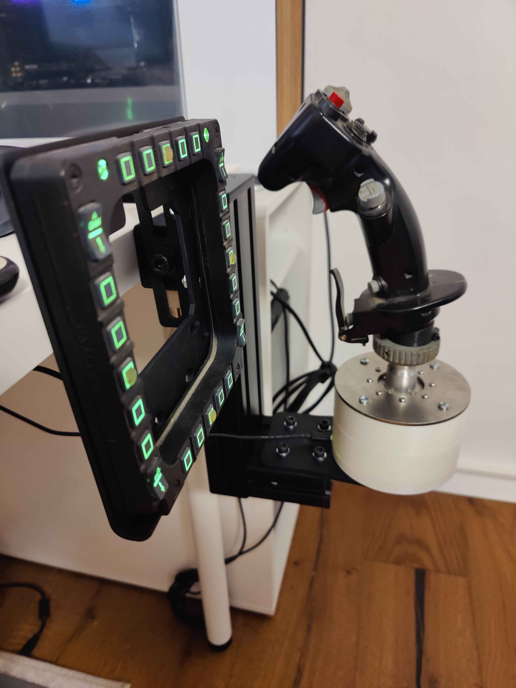

## How it looks

| On the bench | With a grip fitted | Mounted |
| --- | --- | --- |
| 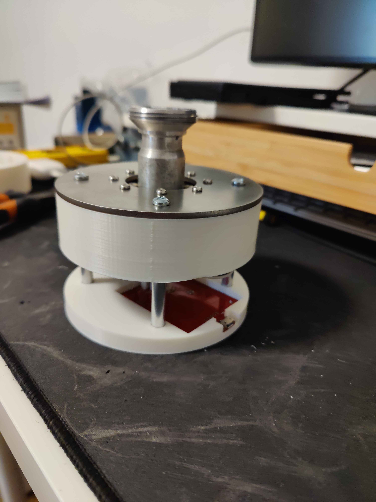 | 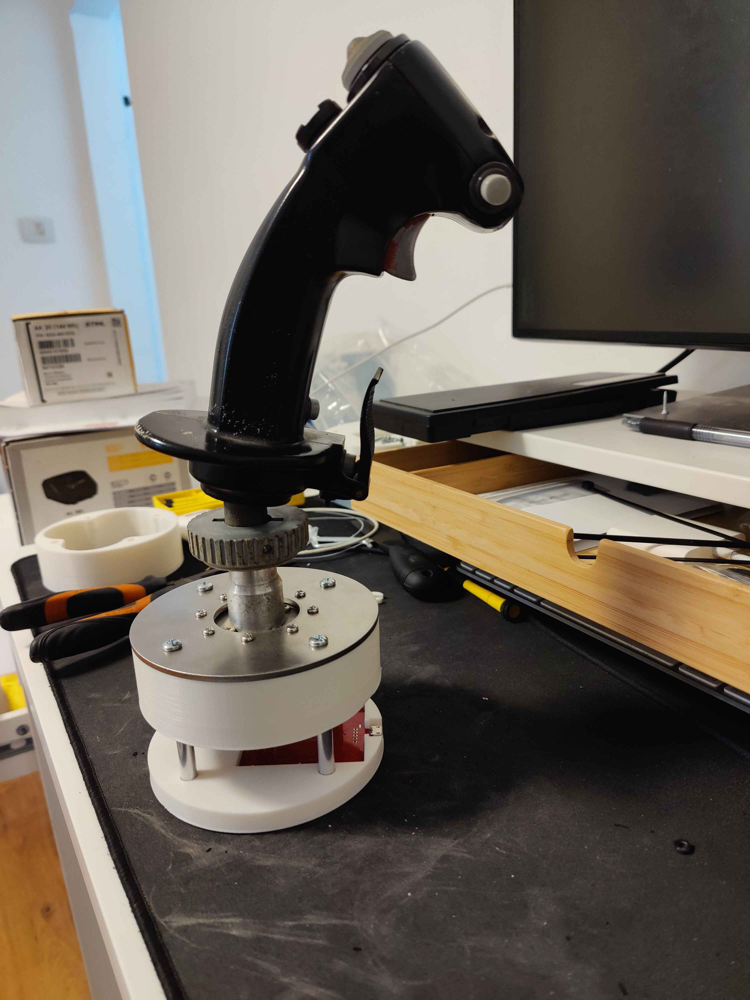 |  |

The photos show the real hardware: the 3 mm stainless top plate, the two white printed body spacers,
the printed controller ring carrying the controller PCB, four 70 mm aluminium standoffs, and the
Monstertech mounting plate underneath for the desk mount.

## Assembly animation

A Fusion 360 animation of the assembly sequence:

## Renders

| | |
| --- | --- |
| 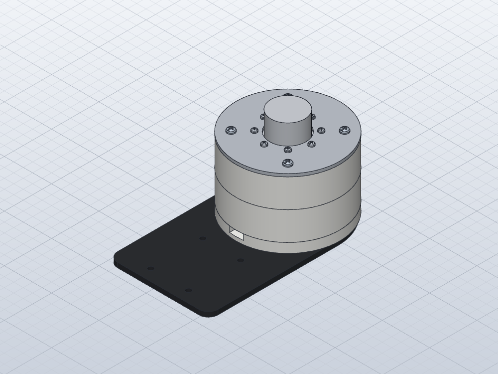 | 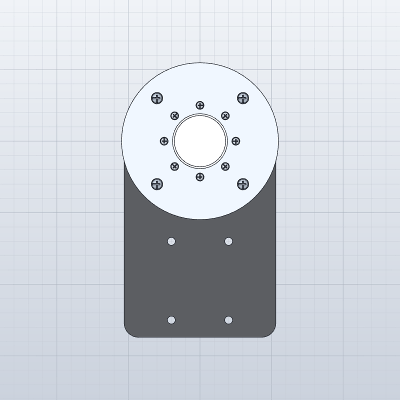 |
| 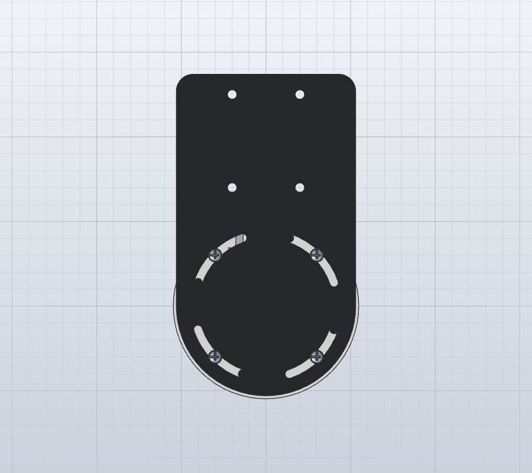 | 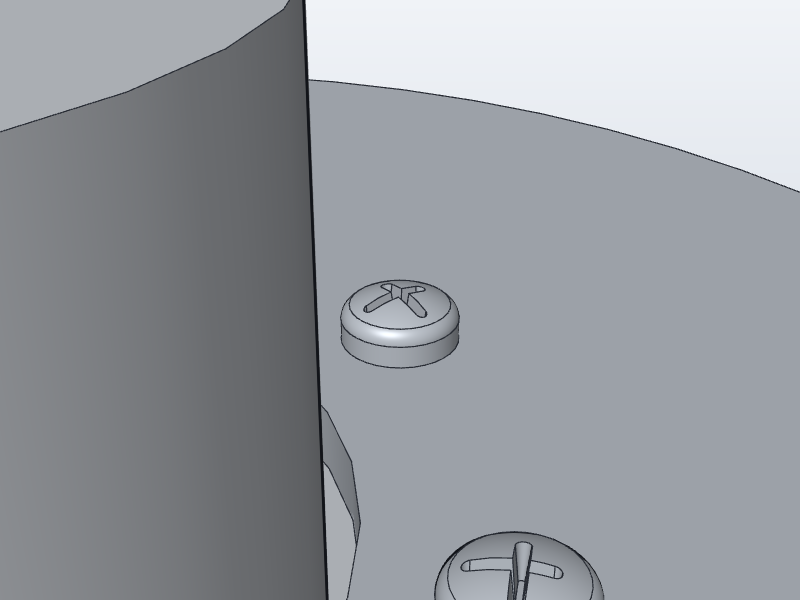 |

Older renders of the original Fusion 360 design are in [`images/`](images):

| | | |
| --- | --- | --- |
| 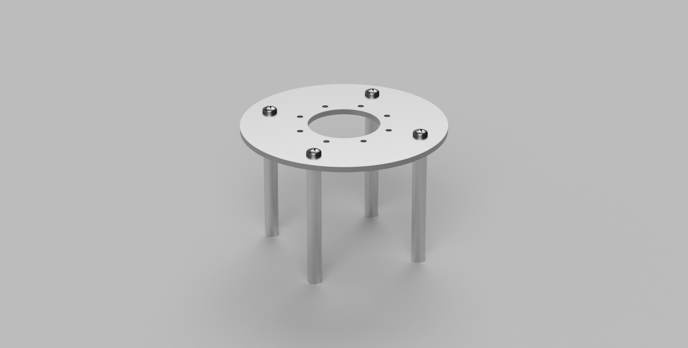 | 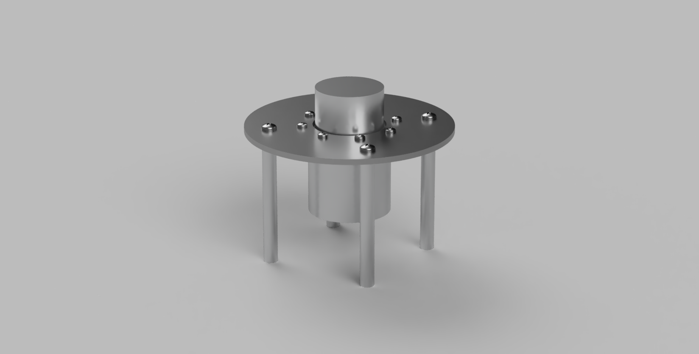 | 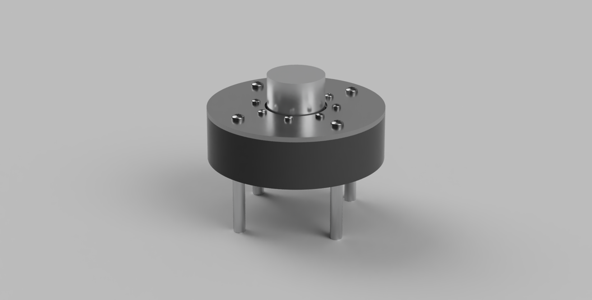 |
| 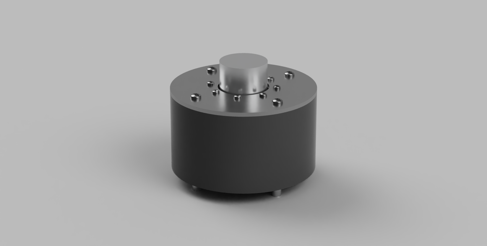 | 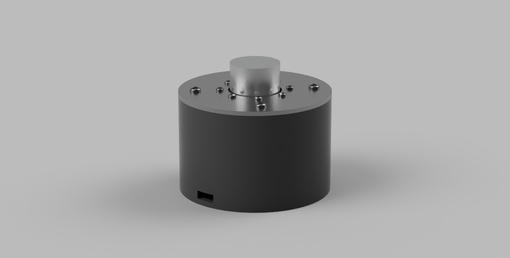 | 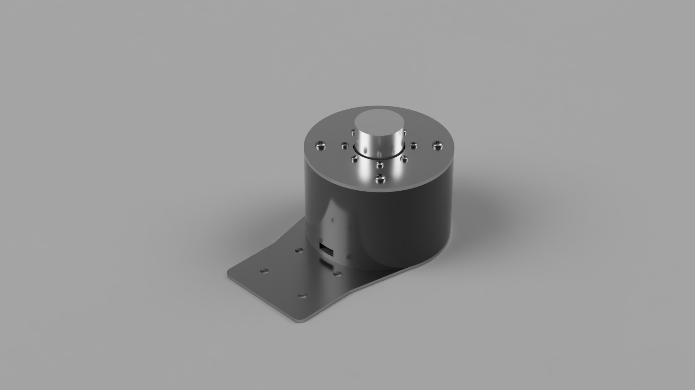 |

## What is in the box

The adapter is a short stack: the top plate is bolted to four 70 mm standoffs, the FCC core hangs
underneath it on eight M3 screws, and two printed rings and a printed tray (the controller ring) sit
around the FCC core and its PCB. The whole stack then bolts onto a desk-mount plate.

**To make:**

* **Top plate** — 3 mm stainless steel, laser cut. Use [`Parts/FCW_Top_plate v36.step`](Parts/FCW_Top_plate%20v36.step) (or `parametric_v1/FCW_v1_top_plate.step`) to have it produced. I used PCBWay, about 30 USD per plate in Dec. 2024.
* **Body spacers ×2** — 3D printed: [`Parts/FCW_body_spacer_0.3mf`](Parts/FCW_body_spacer_0.3mf), [`Parts/FCW_body_spacer_1.3mf`](Parts/FCW_body_spacer_1.3mf).
* **Controller ring ×1** — 3D printed: [`Parts/FCW_Controller_Ring.3mf`](Parts/FCW_Controller_Ring.3mf).

**To buy:**

* 4× 70 mm M4 aluminium standoffs (threaded both ends).
* 4× M4 screws for the top plate, 4× M4 screws for the desk-mount plate (M4×10 and M4×14 were used).
* 8× M3×12 pan head screws and 8× M3 nuts to fix the FCC core to the plate.

## The model

The original Fusion 360 project is exported here as `complete assembly/FCW v38.step` (+ the `.f3z`
archive). Because the archive keeps no readable feature tree, the adapter has also been rebuilt as a
fully parametric design in [SolidCraft](https://solidcraft.app) — see
[`parametric_v1/`](parametric_v1/README.md):

* 6 components (top plate, body spacers, controller mount, FCC mockup, external hardware, mounting
  plate), 34 bodies, 69 features, every solid sketch-driven;
* the fabricated parts are verified against the Fusion export (top plate and body spacer come out as
  *identical solids*, the controller ring within 0.001 %);
* hardware modelled as real parts (pan head Phillips screws, ISO 4032 nuts, standoffs) with materials
  and masses set;
* the parameters tie everything together: change the printed stack height and the standoffs, plate and
  screws follow.

| File | What it is |
| --- | --- |
| `complete assembly/FCW v38.step` | The original assembly export |
| `complete assembly/FCW v38.f3z` | The original Fusion 360 archive |
| `Parts/` | Print files and the laser-cut plate STEP |
| `images/` | Renders of the original design |
| `parametric_v1/` | The parametric rebuild (`.sc` design, STEP/3MF exports, renders) |

## License

MIT — see [LICENSE](LICENSE). The FCC core itself is not part of this project; it is only shown for
reference.
