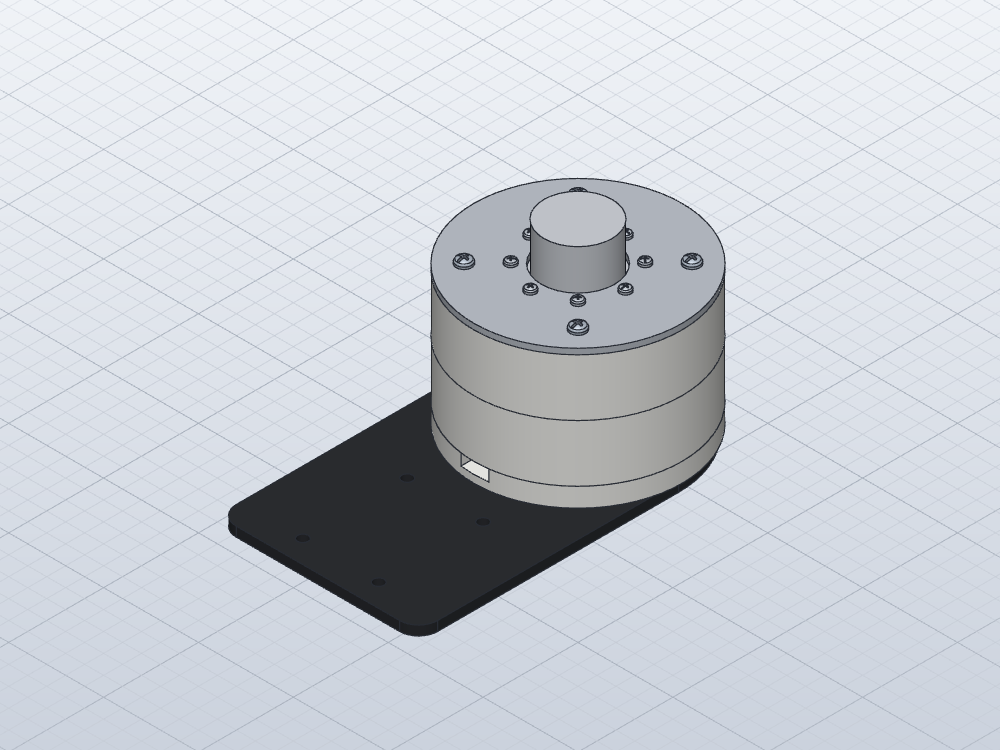
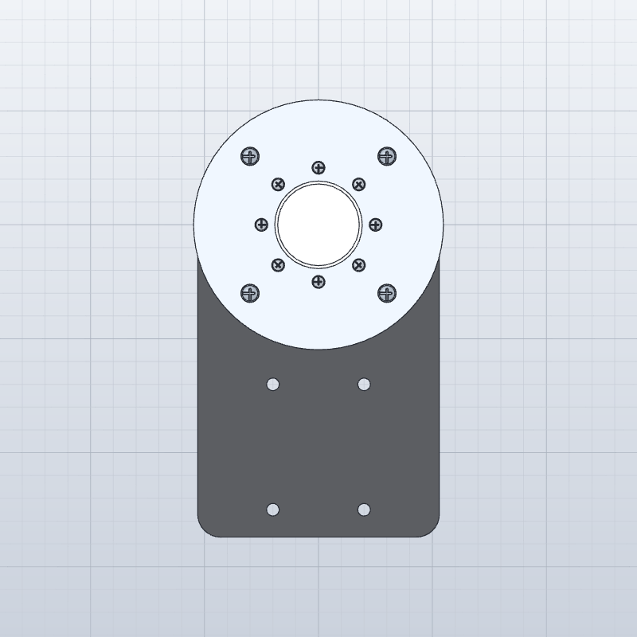
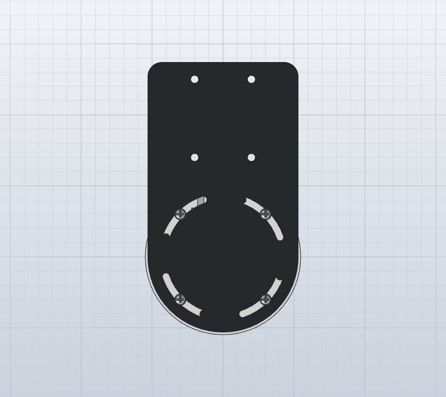
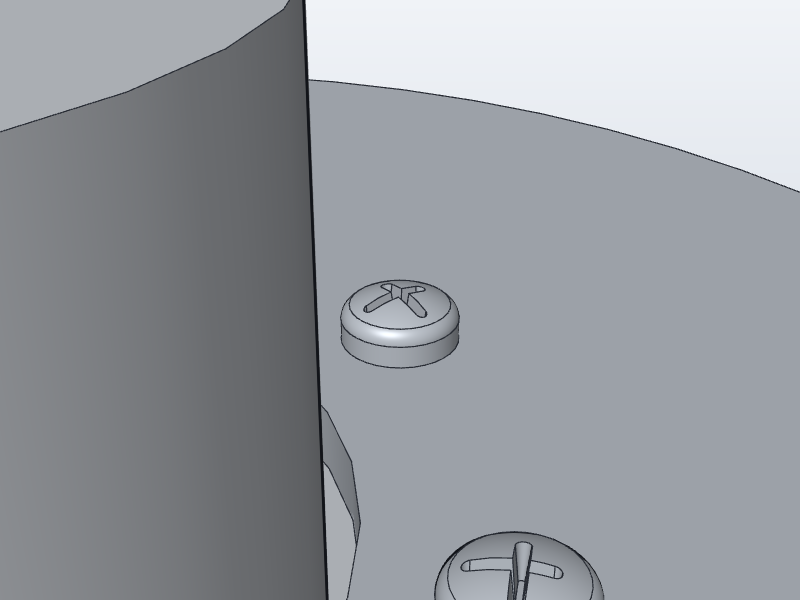
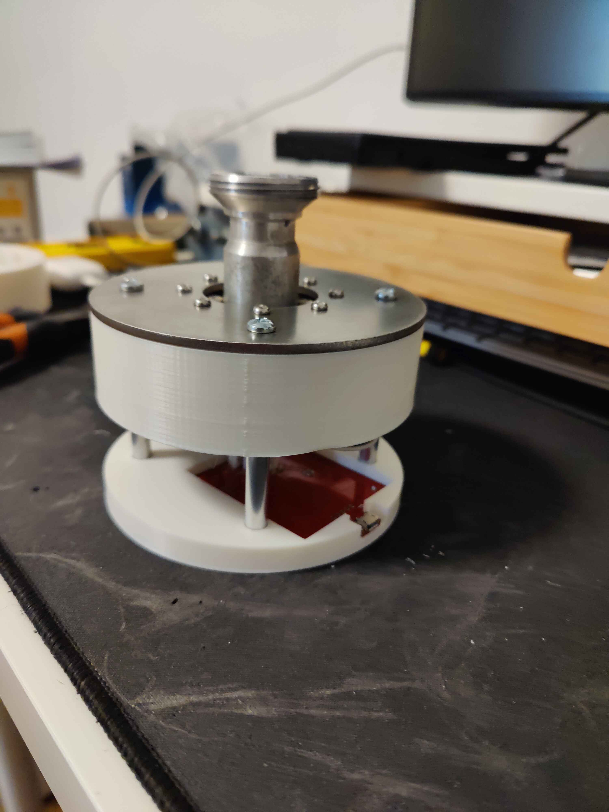
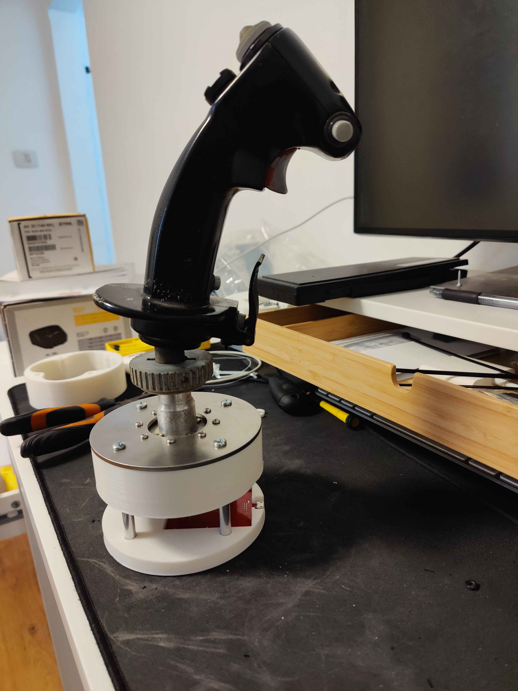
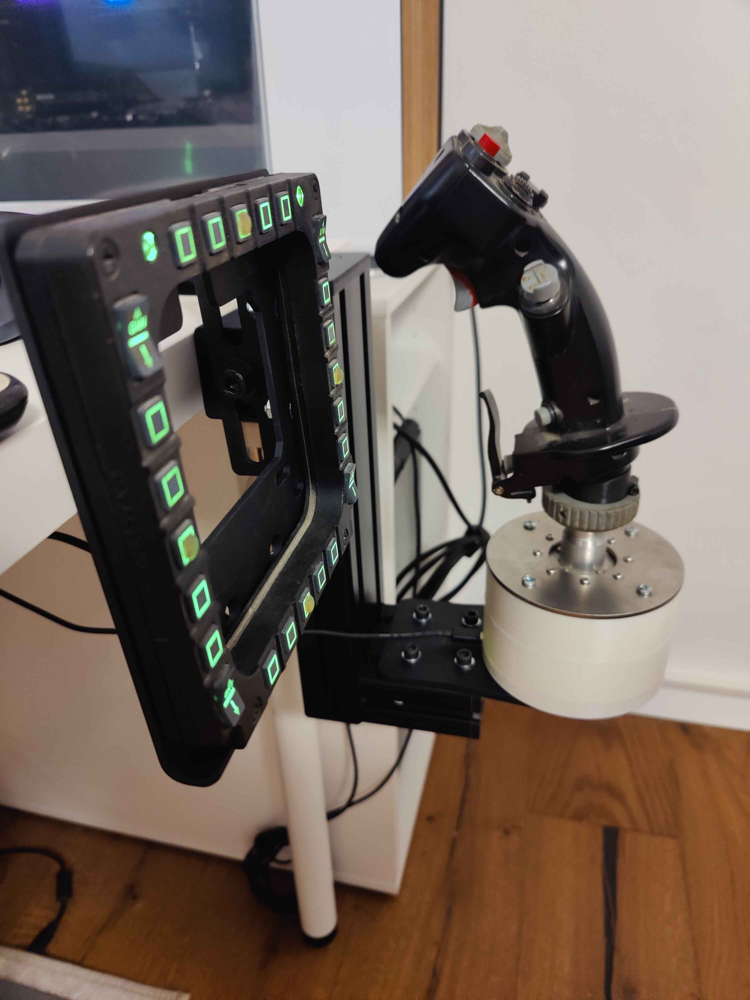

# FCW parametric model (SolidCraft)

The FCC-to-Warthog adapter: a laser-cut top plate on four 70 mm standoffs, two printed body spacers
and a printed controller ring, with the FCC core hanging underneath.

Reverse-engineered from what survived in this repo — `complete assembly/FCW v38.step`, the
`Parts/*.3mf` print files and the plate drawing — because the Fusion archive (`FCW v38.f3z`) keeps
only the assembly and standard-part copies, no readable feature tree or parameters.

Every part is built **inside its own component**, each solid comes from a sketch, and the root
component holds nothing but the parameters: 69 features, 26 sketches, 34 bodies, 6 components.

## What has to be made

| Part | How | File | Qty |
| --- | --- | --- | --- |
| Top plate | 3 mm stainless, laser cut | `FCW_v1_top_plate.step` (the original export of the same part is `../Parts/FCW_Top_plate v36.step`) | 1 |
| Body spacer | 3D printed | `FCW_v1_body_spacer.step` / `.3mf` | **2** |
| Controller ring | 3D printed (PCB / wiring tray) | `FCW_v1_controller_ring.step` / `.3mf` | 1 |

Everything else in the assembly is reference or off-the-shelf hardware:

| Part | Role |
| --- | --- |
| `Monstertech Mounting Plate` | placeholder for the desk-mount interface (slots exact, the rest estimated) |
| `FCC Mockup` | the FCC core, for fit checks only |
| `External Hardware` | bought: 4× 70 mm M4 standoffs, 4× M4×10 + 4× M4×14 (4 come through the steel plate from above, 4 through the mounting plate from below), 8× M3×12, 8× M3 nuts |

## Renders



*Iso: white printed spacers and ring, stainless top plate, black mounting plate with the tail to the front.*



*Top: 8× M3 screws onto the FCC flange, 4× M4 heads at the corners, FCC boss through the bore.*



*Bottom: the four M4 screws come up through the curved slots of the mounting plate.*



*Detail: pan-head Phillips M3 with the crowned head and cross recess.*

## Build photos

The real hardware during testing, initial assembly and mounted on the desk mount. The FCC core in
these photos is the actual part; `FCC Mockup` in the model is a simplified stand-in that was mostly
needed for clearance measurements.



*Assembled adapter: stainless plate with 8 M3 heads and 4× M4 heads, the two white printed spacers, the 4 aluminium standoffs showing above the white controller ring, the controller PCB in the ring's tray, and the FCC core's boss through the plate bore.*



*Initial assembly with a grip on the FCC core.*



*Mounted: the black Monstertech plate clamped by the desk mount, the adapter sitting on it, panel with the button box in the background.*

## Components

| Component | Features | Sketches | Bodies |
| --- | --- | --- | --- |
| `Top Plate` | 1 — `Plate` | `PlateProfile` | 1 |
| `Body Spacers` | 2 — `Body Spacer`, `Both Body Spacers` | `BodySpacerProfile` | 2 |
| `Controller Mount` | 6 — `Ring`, `RingPocket`, `CableSlotOuter`, `FloorCableCut`, `StudBosses`, `StudPins` | `RingProfile`, `RingPocketCut`, `RingSlotCut`, `RingFloorCut`, `RingStuds`, `RingPins` | 1 |
| `FCC Mockup` | 2 — `FCCBody`, `FCCFlangeHoleCut` | `FCCProfile`, `FCCFlangeHoles` | 1 |
| `External Hardware` | 24 — standoffs, 4 screw sets (4 top + 4 bottom M4), nut set | `M4SpacerProfile`, `M3ScrewProfile`, `M3Phillips`, `M4 Screw 10Profile`, `M4 Screw 10Phillips`, `M4 Screw 14Profile`, `M4 Screw 14Phillips`, `M4 Screw Top 10Profile`, `M4 Screw Top 10Phillips`, `M4 Screw Top 14Profile`, `M4 Screw Top 14Phillips`, `NutProfile` | 28 |
| `Monstertech Mounting Plate` | 4 — `MountingPlate`, `MountingPlateSlotsCut`, `MountingPlateStepCut`, `MountingPlateHolesCut` | `MountingPlateProfile`, `MountingPlateSlots`, `MountingPlateStep`, `MountingPlateHoles` | 1 |

## Files

| File | What it is |
| --- | --- |
| `FCW_parametric_v1.sc` | The design (open in SolidCraft) |
| `FCW_v1_assembly.step` | Full assembly — 7 products: `FCW_parametric_v1` + the six components |
| `FCW_v1_top_plate.step` | 3 mm laser-cut plate |
| `FCW_v1_body_spacer.step` / `.3mf` | Printed body spacer (make **2**) |
| `FCW_v1_controller_ring.step` / `.3mf` | Printed controller ring |
| `FCW_v1_hardware.step` | All 24 hardware bodies |
| `FCW_v1_mounting_plate.step` | The Monstertech plate placeholder |
| `FCW_v1_fcc_mockup.step` | FCC core reference body |
| `FCW_v1_m3_screw.step`, `FCW_v1_m4_screw_14.step`, `FCW_v1_m3_nut.step` | Individual fasteners |
| `FCW_v1_render_*.png` | Renders (iso, top, bottom, screw detail) |
| `reference_build_adapter.jpg`, `reference_build_grip.jpg`, `reference_build_mounted.jpg` | Photos of the real hardware |
| `reference_monstertech_mounting_plate.jpg` | The product photo the plate was modelled from |

3MFs are exported in assembly position; drop them to the bed in the slicer.

## Coordinates

Z up, origin at the underside of the four 70 mm standoffs — which is now the top face of the
Monstertech plate. The adapter's plate underside is at **z = 70**. **Front is -Y**: the cable slot in
the controller ring and the tail of the mounting plate both point that way. This is the Fusion
assembly turned a quarter turn: `(x, y_fusion, z_fusion) -> (x, -z_fusion, y_fusion + 70)`.

Stack: mounting plate -5…0, controller ring 0…10, body spacers 10…40 and 40…70, plate 70…73; the FCC
core hangs from the plate (Ø43.4 body from 26.25, flange 66.25…68.25, Ø35.822 boss through the plate
bore to 93.25). `spacer_len = 2*body_h + ring_h` ties the printed stack to the 70 mm hardware
spacers, and `z_plate = spacer_len` makes the plate follow it.

## Parameters

### Size and bolt patterns

| Name | Value | Meaning |
| --- | --- | --- |
| `d_outer` | 109.6 mm | Outside diameter of plate, body spacers and controller ring |
| `plate_t` | 3 mm | Plate thickness |
| `corner_c` | 30.05 mm | Corner bolt pattern: centres at ±`corner_c` in X and Y (60.1 square, 42.5 diagonal) |
| `plate_m4_d` | 4.5 mm | M4 clearance in the plate |
| `plate_bore_d` | 38.4 mm | Plate centre bore, clearing the FCC boss |
| `m3_bc_r` | 25.05 mm | Bolt circle radius of the eight FCC M3 screws |
| `m3_plate_d` | 3.4 mm | M3 clearance in the plate |
| `m3_flange_d` | 3.8 mm | M3 clearance in the FCC flange |

### Body spacers (printed ×2)

| Name | Value | Meaning |
| --- | --- | --- |
| `body_h` | 30 mm | Height of one spacer |
| `gap` | 3.4 mm | Bore wall at the sides **and** clearance around the corner spacers |
| `spacer_d` | 7.5 mm | M4 spacer OD = the pass hole through the printed parts |

The bore is not a cylinder: it is the outside diameter offset inward by `gap`, with the four corner
pass holes wrapped at `spacer_d/2 + gap`, joined by tangent blends — so the wall is a constant
3.4 mm and the screws get 3.4 mm of material around them. Derived:

```
W  = d_outer/2 - gap                                  = 51.4      (bore apex radius)
rc = spacer_d/2 + gap                                 = 7.15      (corner clearance radius)
a  = (2*corner_c^2 - (W+rc)^2) / (2*(corner_c-W-rc))  = 28.4579   (blend arc centre offset)
R  = W - a                                            = 22.9421   (blend arc radius)
```

`t_x`, `t_y` are the tangency points; `BodySpacerProfile` holds the outer circle, the four corner
holes and the eight tangent arcs.

### Controller ring (printed)

| Name | Value | Meaning |
| --- | --- | --- |
| `ring_h` | 10 mm | Ring height |
| `ring_floor` | 2 mm | Floor thickness |
| `pocket_w` | 50.8 mm | Wiring pocket width (X) |
| `pocket_l` | 56.8 mm | Wiring pocket length (Y) |
| `pocket_off` | 17.75 mm | Pocket centre offset toward the front |
| `slot_w1` / `slot_step` | 10.66 mm / 2 mm | Cable slot inner section width / length |
| `slot_w2` / `slot_deep2` | 14.66 mm / 6 mm | Cable slot outer section width / depth |
| `lcut_x_out/step/in` | -22.27 / -17.87 / -13.47 mm | Stepped cable cut-out in the floor |
| `lcut_y_back/mid/front` | -24.75 / -34.45 / -44.15 mm | … its Y edges |
| `stud1_x/y`, `stud2_x/y` | -20.265/-16.85, 20.4/-40.15 mm | The two studs on the pocket floor |
| `stud_boss_d/h`, `stud_pin_d/h` | 5.6/2, 1.6/2 mm | Stud boss and pin |

### FCC reference body (not a part to make)

`fcc_body_d` 43.4, `fcc_body_h` 40, `fcc_flange_d` 56.8, `fcc_flange_t` 2, `fcc_boss_d` 35.822,
`fcc_boss_h` 25, `fcc_gap` 1.75 (flange top to plate underside).

### Hardware

| Name | Value | Meaning |
| --- | --- | --- |
| `spacer_len` | `2*body_h + ring_h` = 70 mm | The four M4 standoffs |
| `spacer_bore_d` | 3.528 mm | M4 tap drill in the standoffs |
| `m4_head_d/h`, `m4_crown_r`, `m4_blend_r`, `m4_under_fillet` | 8 / 3.1 / 6.5 / 1.2 / 0.4 mm | M4 pan head (ISO 7045) |
| `m4_thread_d`, `m4_tip_chamfer` | 3.908 / 0.383 mm | Thread envelope and tip chamfer |
| `m4_short`, `m4_long` | 10, 14 mm | Two screws of each length |
| `m4_phil_*`, `m4_phil_half` | 4.4 / 0.83 / 2.4 mm, 6° / 0.581 mm | Phillips cross recess |
| `m3_head_d/h`, `m3_crown_r`, `m3_blend_r`, `m3_under_fillet` | 5.6 / 2.4 / 5 / 0.8 / 0.3 mm | M3 pan head |
| `m3_thread_d`, `m3_tip_chamfer`, `m3_len` | 2.928 / 0.271 / 12 mm | M3 thread envelope, tip chamfer, length |
| `m3_phil_*`, `m3_phil_half` | 2.8 / 0.43 / 1.75 mm, 6° / 0.301 mm | M3 Phillips cross recess |
| `m3_nut_af`, `m3_nut_h`, `m3_nut_bore` | 5.5, 2.4, 2.528 mm | ISO 4032 M3 nut |
| `nut_chamfer` / `nut_chamfer_side`, `nut_csk` / `nut_csk_ax` | 0.48/0.277, 0.236/0.408 mm | Nut face chamfers and bore countersinks |

Each screw is a revolved axial profile — domed crown, side blend, fillet under the head, unthreaded
shank, thread relief, thread envelope, chamfered tip — with a drafted cross recess. The `m3h_*` /
`m4h_*` parameters are the profile numbers taken off the Fusion parts.

### Monstertech mounting plate (placeholder)

Sits under the controller ring and is what the adapter hangs from on the desk mount. Four M4 screws
come **up through its slots from below** into the four 70 mm standoffs; those are in addition to the
four M4 screws on top of the steel plate, which clamp the plate to the standoffs' upper ends — the
build photos show both sets. Modelled with its tail along **−X**; the component occurrence is turned
**90° CCW**, so in the assembly the tail points to the front (−Y) like the USB cable slot. The four
curved slots sit on the standoff bolt circle, `mt_slot_r = corner_c*sqrt(2)` = 42.5 mm, with a screw
in the middle of each.

| Name | Value | Meaning |
| --- | --- | --- |
| `mt_t` | 5 mm | Plate thickness |
| `mt_end_r` | 53 mm | Round-end radius (= half the plate width) |
| `mt_len` | 190 mm | Overall length |
| `mt_tail_r` | 10 mm | Corner radius of the tail |
| `mt_slot_r` | `corner_c*sqrt(2)` | 42.5 — slot centreline radius |
| `mt_slot_w`, `mt_slot_span` | 5 mm, 52° | Slot width and arc span (4 slots at 45/135/225/315°) |
| `mt_step_r`, `mt_step_d` | 30, 1 mm | Central circular step (Ø60 × 1 recess on top) |
| `mt_hole_d` | 5.5 mm | Mount-screw holes (M5 clearance) |
| `mt_h1_x`, `mt_h2_x`, `mt_hole_y` | −125, −70, ±20 mm | The four mount holes |

## Materials

Looks (`appearance.assign`) and physical materials (`material.assign`) are set per component/body:

| Part | Look | Physical material | Mass |
| --- | --- | --- | --- |
| Top plate | Metal – Soft Satin Stainless | Stainless Steel | 195 g |
| Body spacers, controller ring | Plastic – Warm White (overridden to #f4f4f0) | PLA | 104 g each, 85 g |
| M3/M4 screws, M3 nuts | Metal – Soft Satin Stainless | Stainless Steel | ≈ 9 g total |
| 70 mm standoffs | Metal – Bead Blast Aluminium | Aluminium | 6.5 g each |
| FCC mockup | Aluminium – Satin | Aluminium | 241 g |
| Monstertech plate | Aluminium – Anodized Black | Steel | 685 g |

Assembly mass ≈ **1.46 kg**. Swapping the printed parts to another plastic is one `material.assign`.

## Verification

Measured against the original Fusion export (boolean symmetric difference for the physical parts):

| Part | Fusion | Rebuilt | Difference |
| --- | --- | --- | --- |
| Top plate | 24419.882 mm³ | 24419.882 mm³ | 0.000 (identical solid) |
| Body spacer | 83733.042 mm³ | 83733.042 mm³ | 0.000 (identical solid) |
| Controller ring | 68602.549 mm³ | 68602.019 mm³ | 0.001 % |
| FCC reference | 89255.971 mm³ | 89255.971 mm³ | 0.000 |
| M4 standoff | 2407.94 mm³ | 2408.21 mm³ | 0.01 % |
| M3×12 pan head | 126.187 mm³ | 124.376 mm³ | 3.0 % (recess form) |
| M4×14 pan head | 276.770 mm³ | 268.881 mm³ | 6.1 % (recess form) |
| M3 nut | 49.461 mm³ | 47.629 mm³ | 3.7 % |
| Monstertech plate | — (placeholder) | 87 297.7 mm³ | — |
| Assembly | 361 732.38 mm³, 29 bodies | 450 009.66 mm³, 34 bodies | + mounting plate, + 4 top M4 screws |

`check_parameters {"set":{"body_h":"35 mm"}}` rebuilds all 69 features with no errors and restores.
The four *bottom* M4 screws are anchored at the mounting plate and keep their length — a taller stack
needs longer bottom screws, while the four top screws stay with the steel plate.

## Known simplifications

* **Threads are cosmetic** — shanks and standoff bores sit at the thread envelope, exactly as in the
  Fusion library parts. `solid.thread … modeled:true` cuts a real thread if needed.
* The Phillips recess is a drafted cross of the right aperture; the Fusion V-recess removes slightly
  less material, hence the few percent above.
* The standoffs are plain tubes (custom part, not a standard fastener).
* The Monstertech plate is a photo-derived placeholder — slots exact, everything else estimated.
* The FCC core is a reference body for fit checks only.

## Typical changes

* `body_h` / `ring_h` — stack height; `spacer_len`, standoff length and plate height follow.
* `d_outer` — all three round parts change together.
* `corner_c` — the Warthog corner pattern: plate holes, standoff positions, pass holes and the
  mounting plate's slot radius all follow.
* `gap` — body spacer wall thickness and corner clearance.
* `pocket_off`, `slot_*`, `lcut_*` — where the FCC wiring exits the ring.
* `m3_len` / `m4_short` / `m4_long` — screw lengths.
* `m*_head_d/h` with `m*_crown_r` / `m*_blend_r` / `m*_under_fillet` — the screw head form.

Re-export from SolidCraft (`export` per body or the whole assembly) after a change.
